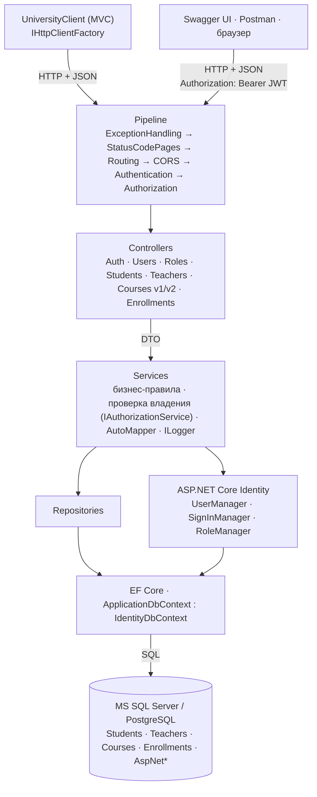

# University Course Management API

REST Web API на **ASP.NET Core 8** для системы управления университетскими курсами: студенты, преподаватели, учебные курсы и записи студентов на курсы.
Данные хранятся в реальной БД (**MS SQL Server** по умолчанию или **PostgreSQL**) через **Entity Framework Core**.

Учебный проект по дисциплине CSE5032 «Разработка веб-сервисов»:
- **задание 1 (модули 1–4)** — CRUD, слои Repository/Service, DTO, AutoMapper, валидация, обработка ошибок, логирование;
- **задание 2 (модули 5–8)** — ASP.NET Core Identity, JWT-аутентификация, роли и политики, проверка принадлежности ресурсов, версии API v1/v2, CORS и отдельное клиентское приложение.

Все возможности задания 1 продолжают работать: коллекция Postman из задания 1 проходит полностью (93 проверки) — теперь под токеном администратора.

## Технологии

| Что | Чем реализовано |
|---|---|
| Web API | ASP.NET Core 8, `[ApiController]`, `ControllerBase`, атрибутная маршрутизация |
| ORM / БД | Entity Framework Core 8, MS SQL Server (миграции) или PostgreSQL (Npgsql) |
| Слои | Controller → Service → Repository → `ApplicationDbContext` |
| Маппинг | AutoMapper 15 (`Mapping/MappingProfile.cs`) |
| Валидация | Data Annotations на DTO + собственный атрибут `[BirthDate]` + `IValidatableObject` |
| Ответы | единый формат `ReturnResult<T>` для всех endpoints, включая 401/403/404/405/415/500 |
| Учётные записи | **ASP.NET Core Identity** + EF Core (`UserManager`, `SignInManager`, `RoleManager`), хеши паролей PBKDF2 |
| Аутентификация | **JWT Bearer** (`Microsoft.AspNetCore.Authentication.JwtBearer`), токен 15 минут |
| Авторизация | роли `Admin` / `Teacher` / `Student`, политики, resource-based проверки владения |
| Версии API | **Asp.Versioning** 8: `/api/v1/...`, `/api/v2/...`, отдельные DTO для v2 |
| CORS | именованная политика `UniversityClients` для двух адресов клиентов |
| Клиент | `UniversityClient` — ASP.NET Core MVC, `IHttpClientFactory` |
| Ошибки | `ExceptionHandlingMiddleware` + события JwtBearer (`OnChallenge`, `OnForbidden`) |
| Логирование | `ILogger` → консоль + файл `UniversityApi/logs/app-ГГГГММДД.log` (без паролей и токенов) |
| Документация | Swagger / OpenAPI: документы v1 и v2, кнопка **Authorize** для JWT |

## Схема архитектуры



## Структура проекта

```
UniversityCourseManagement/
├── UniversityCourseManagement.sln
├── UniversityApi/                          ← Web API
│   ├── Auth/                               роли и политики, claims, JwtSettings, JwtTokenService,
│   │                                       ICurrentUser, обработчики проверки владения ресурсами
│   ├── Controllers/
│   │   ├── AuthController.cs               POST register/login, GET me
│   │   ├── UsersController.cs, RolesController.cs   управление пользователями и ролями (Admin)
│   │   ├── V1/CoursesController.cs         курсы v1 (+ прежний адрес /api/courses)
│   │   ├── V2/CoursesController.cs         курсы v2 (преподаватель + число студентов)
│   │   └── Students, Teachers, Enrollments, Diagnostics
│   ├── Models/                             Student, Teacher, Course, Enrollment, ApplicationUser (Identity)
│   ├── DTO/                                Students/ Teachers/ Courses/ (+ V2/) Enrollments/ Auth/ Users/
│   ├── Data/
│   │   ├── ApplicationDbContext.cs         IdentityDbContext<ApplicationUser>
│   │   ├── Configurations/                 Fluent API (Course, Enrollment, ApplicationUser)
│   │   └── Seed/                           DbSeeder (данные), IdentitySeeder (роли, демо-пользователи)
│   ├── Migrations/                         InitialCreate, AddIdentityAndRoles (SQL Server)
│   ├── Repositories/, Services/, Mapping/, Middleware/, Common/
│   ├── Extensions/                         DI, SecurityExtensions (Identity/JWT/политики/CORS/версии), Swagger
│   └── Program.cs
├── UniversityClient/                       ← клиент ASP.NET Core MVC (задание 2, п. 1)
│   ├── Services/UniversityApiClient.cs     HTTP-клиент через IHttpClientFactory + обработка ошибок
│   ├── Controllers/, Views/, wwwroot/
│   └── appsettings.json                    адрес API (UniversityApi:BaseUrl)
├── database/sqlserver/                     01_schema.sql, 02_seed_data.sql, 03_identity.sql
├── database/postgresql/                    university_course_db_dump.sql
├── postman/
│   ├── UniversityApi.postman_collection.json            задание 1 (CRUD, под токеном Admin)
│   └── UniversityApi.Security.postman_collection.json   задание 2 (12 сценариев безопасности)
├── scripts/setup-dev-secrets.ps1 (.sh)     генерация ключа JWT в User Secrets
└── docs/defense-notes.md                   шпаргалка к защите
```

## Запуск

Нужен **.NET SDK 8** или новее (проекты собраны под `net8.0` с `RollForward=Major`, поэтому запускаются и на .NET 9/10).

### 1. Ключ подписи JWT (один раз)

Ключ **не хранится** ни в коде, ни в `appsettings.json`, ни в Git. Для разработки он лежит в **User Secrets** — файле в профиле пользователя Windows (`%APPDATA%\Microsoft\UserSecrets\university-course-management-api-5f3c1a\secrets.json`):

```powershell
powershell -ExecutionPolicy Bypass -File scripts/setup-dev-secrets.ps1
# или вручную:
dotnet user-secrets set "Jwt:Key" "<случайная строка от 32 символов>" --project UniversityApi
```

Если ключ не задан, в Development API сгенерирует временный случайный ключ (с предупреждением в логе: после перезапуска токены станут недействительны). В Production без ключа приложение **не запустится** — ключ передаётся переменной окружения `Jwt__Key`.

### 2. API

**MS SQL Server LocalDB (по умолчанию).** LocalDB ставится вместе с Visual Studio. Строка подключения уже в `appsettings.json`:

```
Server=(localdb)\MSSQLLocalDB;Database=UniversityCourseDb;Trusted_Connection=True;TrustServerCertificate=True
```

```bash
cd UniversityApi
dotnet run --launch-profile http
```

При запуске приложение само применит миграции (если база осталась от задания 1 — добавит только таблицы Identity), заполнит пустую базу тестовыми данными, создаст роли и демо-пользователей.
Swagger: **http://localhost:5096/swagger** (корень `/` перенаправляет туда же).

**PostgreSQL.** В `appsettings.json` поменять `"Provider": "PostgreSql"`. Схема создаётся из модели через `EnsureCreated()`; если база создана ещё в задании 1, приложение добавит в неё только недостающие таблицы Identity.

**Восстановить БД из скриптов (SQL Server):** `01_schema.sql` → `02_seed_data.sql` → `03_identity.sql`. Роли и пользователей создаст приложение при первом запуске.

### 3. Клиент

```bash
cd UniversityClient
dotnet run --launch-profile http
```

Открыть **http://localhost:5210**. Адрес API задаётся в `UniversityClient/appsettings.json` → `UniversityApi:BaseUrl`.
В Visual Studio: открыть `UniversityCourseManagement.sln` → ПКМ по решению → «Configure Startup Projects» → «Multiple startup projects» → `UniversityApi` и `UniversityClient`, профиль `http`.

### Демо-пользователи (только Development)

Создаются при запуске, если в конфигурации есть `Seed:DemoUsersPassword` (он есть только в `appsettings.Development.json`). Пароль у всех: **`Demo#2026`**.

| Пользователь | Роль | Связан с | Что важно для сценариев |
|---|---|---|---|
| `admin` | Admin | — | управление пользователями и ролями, все данные |
| `teacher.abenov` | Teacher | Teacher Yerlan Abenov | ведёт «Web Services Development» и «Software Testing» |
| `teacher.sadykova` | Teacher | Teacher Gulnara Sadykova | ведёт «Databases» (чужой курс для Абенова) |
| `student.bekova` | Student | Student Aruzhan Bekova | 3 записи с оценками |
| `student.omarov` | Student | Student Nursultan Omarov | его оценки — «чужие» для Бековой |

## Аутентификация и авторизация

**Аутентификация** — «кто ты»: `POST /api/auth/login` проверяет пароль через Identity и выдаёт JWT; дальше каждый запрос несёт `Authorization: Bearer <token>`, и `UseAuthentication()` восстанавливает по нему пользователя (`HttpContext.User`).
**Авторизация** — «что тебе можно»: `UseAuthorization()` проверяет `[Authorize]`, роли и политики; сервисы дополнительно проверяют, принадлежит ли ресурс пользователю.

| Ответ | Когда |
|---|---|
| **401** `UNAUTHORIZED` | токен не передан |
| **401** `TOKEN_EXPIRED` | срок действия токена истёк |
| **401** `INVALID_TOKEN` | подпись не совпадает (токен изменён), чужой издатель/аудитория, мусор вместо токена |
| **401** `INVALID_CREDENTIALS` / `ACCOUNT_LOCKED` | неверный логин/пароль или учётная запись заблокирована |
| **403** `FORBIDDEN` | пользователь аутентифицирован, но роли/прав недостаточно |
| **403** `NOT_COURSE_TEACHER` | преподаватель пытается работать с оценками чужого курса |
| **403** `ACCOUNT_NOT_LINKED` | учётная запись Teacher/Student не связана с сущностью Teacher/Student |

### JWT

- Claims: `sub` (id пользователя), `name` (имя), `role` (роли), `student_id` / `teacher_id` (связь с сущностью), `jti`, `iss`, `aud`, `exp`.
- Проверяются подпись (HMAC-SHA256), издатель, аудитория, срок действия (`ClockSkew = 0`). Алгоритм `none` и изменённый payload отклоняются.
- Срок действия — 15 минут (`Jwt:AccessTokenMinutes`). Изменение ролей попадает в токен при следующем входе.
- Пароль, хеш пароля и другие секреты в токен не пишутся: payload JWT только закодирован Base64Url, а не зашифрован.

### Identity

- Регистрация `POST /api/auth/register` — пользователь всегда получает роль **Student**; поля роли в DTO нет.
- Пароль: минимум 8 символов, цифра, строчная и заглавная буквы. Имя пользователя и email уникальны (409).
- 5 неверных паролей подряд — блокировка на 5 минут (`ACCOUNT_LOCKED`). Снять досрочно может Admin: `POST /api/users/{id}/unlock`.
- Пароли хранятся только как хеш Identity (PBKDF2 с солью) в `AspNetUsers.PasswordHash`.
- Учётная запись связывается с существующими `Student`/`Teacher` полями `ApplicationUser.StudentId` / `TeacherId` (`PUT /api/users/{id}/profile`).

### Роли, политики и проверка владения

| Политика | Требование | Где |
|---|---|---|
| `AdminOnly` | роль Admin | создание/изменение/удаление студентов, преподавателей, курсов, записей; `/api/users`, `/api/roles` |
| `Staff` | Admin или Teacher | список студентов |
| `GradeManagement` | Admin или Teacher со связанным `teacher_id` | изменение оценки |
| без политики, `[Authorize]` | любой аутентифицированный | профиль студента, записи (дальше — проверка владения) |
| `[AllowAnonymous]` | — | курсы v1/v2 (чтение), преподаватели (чтение), регистрация, вход |

Контроллеры «закрыты по умолчанию»: `MapControllers().RequireAuthorization()` — action без `[AllowAnonymous]` требует токен.

**Почему одной роли недостаточно.** Роль `Teacher` разрешает менять оценки, но не говорит, *чьи*. Поэтому сервисы вызывают `IAuthorizationService.AuthorizeAsync(user, resource, operation)`, а обработчики `EnrollmentAuthorizationHandler` и `StudentAuthorizationHandler` сравнивают `teacher_id` / `student_id` из токена с владельцем ресурса:
- Teacher меняет оценку только если `course.TeacherId == teacher_id` (иначе 403 `NOT_COURSE_TEACHER`);
- Student видит записи и оценки только если `enrollment.StudentId == student_id`; запрос `?studentId=<чужой>` — 403;
- Teacher видит записи только своих курсов.

## Версии API

| | v1 | v2 |
|---|---|---|
| Адрес | `/api/v1/courses`, `/api/v1/courses/{id}` (и прежний `/api/courses`) | `/api/v2/courses`, `/api/v2/courses/{id}` |
| DTO | `CourseDto` — без изменений с задания 1 | `CourseV2Dto`: `teacher { id, fullName, department }`, `enrolledStudentsCount` |
| Swagger | документ **v1** (все ресурсы) | документ **v2** (курсы v2 + авторизация) |

Логика не дублируется: оба контроллера вызывают `ICourseService`, где фильтрация и поиск реализованы один раз (`LoadFilteredAsync`), версии отличаются только маппингом в DTO. Остальные ресурсы (`/api/students`, …) без сегмента версии считаются v1. Неподдерживаемая версия (`/api/v3/...`) → 404 `UNSUPPORTED_API_VERSION`. В ответах есть заголовок `api-supported-versions: 1.0, 2.0`.

## CORS

Политика `UniversityClients` разрешает запросы из браузера только с адресов из `appsettings.json → Cors:AllowedOrigins`:
`http://localhost:5210` (UniversityClient) и `http://localhost:3000` (место для SPA-клиента). Методы GET/POST/PUT/DELETE, заголовки `Authorization`, `Content-Type`, `Accept`.

MVC-клиент обращается к API со своего сервера, CORS на такие запросы не влияет. Чтобы показать CORS, в клиенте есть страница **CORS-демо** (`/Home/Cors`): запрос делает сам браузер — с `http://localhost:5210` он проходит, а если открыть ту же страницу как `http://127.0.0.1:5210`, браузер его заблокирует.

## Endpoints

| Метод | URL | Доступ | Успех | Ошибки |
|---|---|---|---|---|
| POST | `/api/auth/register` | все | 201 | 400, 409 |
| POST | `/api/auth/login` | все | 200 + JWT | 400, 401 |
| GET | `/api/auth/me` | аутентифицированный | 200 | 401 |
| GET | `/api/users`, `/api/users/{id}` | Admin | 200 | 401, 403, 404 |
| POST | `/api/users/{id}/roles` `{ "role": "Teacher" }` | Admin | 200 | 401, 403, 404 |
| DELETE | `/api/users/{id}/roles/{role}` | Admin | 200 | 401, 403, 404, 409 |
| PUT | `/api/users/{id}/profile` `{ "studentId": 1, "teacherId": null }` | Admin | 200 | 401, 403, 404, 409 |
| POST | `/api/users/{id}/unlock` | Admin | 200 | 401, 403, 404 |
| GET / POST | `/api/roles` | Admin | 200 / 201 | 401, 403, 409 |
| GET | `/api/students?search=` | Admin, Teacher | 200 | 401, 403 |
| GET | `/api/students/{id}`, `/api/students/{id}/courses` | Admin, Teacher, сам студент | 200 | 401, 403, 404 |
| POST / PUT / DELETE | `/api/students[/{id}]` | Admin | 201 / 200 | 400, 401, 403, 404, 409 |
| GET | `/api/teachers`, `/api/teachers/{id}` | все | 200 | 404 |
| POST / PUT / DELETE | `/api/teachers[/{id}]` | Admin | 201 / 200 | 400, 401, 403, 404, 409 |
| GET | `/api/v1/courses?search=&teacherId=&department=&minCredits=&maxCredits=` | все | 200 | 400 |
| GET | `/api/v1/courses/{id}` | все | 200 | 404 |
| POST / PUT / DELETE | `/api/v1/courses[/{id}]` | Admin | 201 / 200 | 400, 401, 403, 404 |
| GET | `/api/v2/courses`, `/api/v2/courses/{id}` | все | 200 | 400, 404 |
| GET | `/api/enrollments?studentId=&courseId=` | Admin — все; Teacher — свои курсы; Student — свои | 200 | 401, 403 |
| GET | `/api/enrollments/{id}` | Admin, преподаватель курса, сам студент | 200 | 401, 403, 404 |
| POST / DELETE | `/api/enrollments[/{id}]` | Admin | 201 / 200 | 400, 401, 403, 404, 409 |
| PUT | `/api/enrollments/{id}/grade` | Admin, преподаватель **этого** курса | 200 | 400, 401, 403, 404 |
| GET | `/api/diagnostics/error` | все (Development) | — | 500 |
| POST | `/api/diagnostics/expired-token` | аутентифицированный (Development) | 200 | 401 |

`/api/courses` (без версии) работает как v1 — для клиентов задания 1.

## Сценарии безопасности (раздел 7)

| № | Сценарий | Результат | Как показать |
|---|---|---|---|
| 1 | Аноним: список курсов | 200 | Swagger `GET /api/v1/courses` без Authorize; клиент |
| 2 | Аноним: создать курс | 401 `UNAUTHORIZED` | Swagger `POST /api/v1/courses` без Authorize |
| 3 | Неправильный пароль | 401 `INVALID_CREDENTIALS`, `result: null` | `POST /api/auth/login` |
| 4 | Правильные данные | 200 + `accessToken` | `POST /api/auth/login` → Authorize → `GET /api/auth/me` |
| 5 | Просроченный JWT | 401 `TOKEN_EXPIRED` | `POST /api/diagnostics/expired-token` → этот токен в Authorize → `GET /api/auth/me` |
| 6 | Student удаляет курс | **403** `FORBIDDEN` (без токена — 401) | вход `student.bekova` → `DELETE /api/v1/courses/1` |
| 7 | Teacher меняет оценку в своём курсе | 200 | `teacher.abenov` → `GET /api/enrollments` → `PUT /api/enrollments/{id}/grade` |
| 8 | Teacher меняет оценку в чужом курсе | 403 `NOT_COURSE_TEACHER` | `teacher.abenov` → `PUT` для записи курса Databases |
| 9 | Student запрашивает чужие оценки | 403 `FORBIDDEN` | `student.bekova` → `GET /api/enrollments?studentId=<id Омарова>` |
| 10 | Admin назначает роль | 200, роль в `roles` | `admin` → `POST /api/users/{id}/roles` |
| 11 | Student назначает себе Admin | 403 `FORBIDDEN` | `student.bekova` → `POST /api/users/{свой id}/roles` |
| 12 | Клиент обращается к v1 и v2 | обе версии 200 | клиент: переключатель «API v1 / API v2»; Swagger: документы v1 и v2 |

> **Сценарий 6.** В таблице задания указан 401, но требование 2.5 говорит: «403 Forbidden, когда пользователь аутентифицирован, но не обладает необходимыми правами». Студент с верным токеном аутентифицирован, поэтому API отвечает 403; 401 он получит, если удалить курс без токена.

## Единый формат ответа `ReturnResult<T>`

```json
{
  "statusCode": 403,
  "isSuccess": false,
  "result": null,
  "errorCode": "NOT_COURSE_TEACHER",
  "errorMessage": "You can change grades only for your own courses",
  "traceId": "0HNPG0P9G1QN9:00000001"
}
```

Для ошибок валидации добавляется поле `errors` со списком сообщений по полям. `traceId` совпадает с идентификатором запроса в логе. В этот формат приводятся и ответы, которые формирует сам ASP.NET Core: 401/403 (события JwtBearer `OnChallenge`/`OnForbidden`), 404 `ENDPOINT_NOT_FOUND`, 405, 415.

| Код | Когда |
|---|---|
| 200 OK | успешное получение, изменение, удаление |
| 201 Created | создание объекта (+ заголовок `Location`) |
| 400 Bad Request | ошибка валидации DTO, некорректный JSON, слабый пароль (`VALIDATION_ERROR`) |
| 401 Unauthorized | нет токена, токен просрочен или изменён, неверный логин/пароль |
| 403 Forbidden | нет роли или ресурс принадлежит другому пользователю |
| 404 Not Found | объект не найден; неподдерживаемая версия API |
| 409 Conflict | повторная запись на курс, занятый email/имя пользователя, удаление преподавателя с курсами |
| 500 Internal Server Error | непредвиденная ошибка; клиенту — только код и `traceId`, подробности — в лог |

## Бизнес-правила (задание 1)

1. Нельзя записать студента на несуществующий курс → 404 `COURSE_NOT_FOUND`.
2. Нельзя записать несуществующего студента → 404 `STUDENT_NOT_FOUND`.
3. Один студент не может быть дважды записан на один курс → 409 `STUDENT_ALREADY_ENROLLED` (плюс уникальный индекс `(StudentId, CourseId)`).
4. Курс не может ссылаться на несуществующего преподавателя → 404 `TEACHER_NOT_FOUND`.
5. Несуществующий объект никогда не возвращается как успех → 404 с кодом `*_NOT_FOUND`.

Дополнительно: email студента и преподавателя уникален (409), нельзя удалить преподавателя, за которым закреплены курсы (409).

## Конфигурация модели EF Core

- **Conventions**: `Id` — первичный ключ, `TeacherId`/`StudentId`/`CourseId` — внешние ключи.
- **Data Annotations** (`Student`, `Teacher`): `[Key]`, `[Required]`, `[MaxLength]`, `[Table]`, `[Index(IsUnique = true)]`.
- **Fluent API** (`Course`, `Enrollment`, `ApplicationUser`): ключи, длины, точность, связи, `OnDelete`, уникальные индексы, CHECK-ограничения. `ApplicationUser → Student/Teacher` — один-к-одному, `OnDelete(SetNull)`: при удалении студента учётная запись остаётся без связи.
- `ApplicationDbContext` наследуется от `IdentityDbContext<ApplicationUser>` — таблицы Identity в той же базе.

## Dependency Injection и lifetime

| Сервис | Lifetime | Почему |
|---|---|---|
| `ApplicationDbContext` | Scoped | один контекст на HTTP-запрос |
| Репозитории, сервисы, `UserManager`, `SignInManager` | Scoped | зависят от `DbContext` |
| `ICurrentUser` | Scoped | читает claims текущего запроса через `IHttpContextAccessor` |
| `ITokenService` | Singleton | без состояния, настройки читаются один раз |
| Обработчики авторизации | Singleton | без состояния, данные получают через параметры |
| AutoMapper | конфигурация — Singleton | правила маппинга строятся один раз |

## Логирование

- **Information** — создание/изменение/удаление, вход, назначение ролей, изменение оценок (с именем пользователя);
- **Warning** — 401/403, неудачный вход, блокировка, отказ в доступе к чужому ресурсу, ошибки валидации;
- **Error** — необработанные исключения (полный StackTrace только в логе).

В лог никогда не пишутся пароли, JWT и ключ подписи: при 401 записывается только тип ошибки (`SecurityTokenExpiredException` и т. п.), при входе — имя пользователя и результат.

> AutoMapper 15 при старте пишет предупреждение об отсутствии лицензионного ключа — для учебного использования это допускается.

## Проверка через Postman

- `postman/UniversityApi.Security.postman_collection.json` — **задание 2**: 12 сценариев + блокировка + очистка, 54 запроса, 117 проверок. Токены и id сохраняются в переменные коллекции, коллекцию можно запускать повторно.
- `postman/UniversityApi.postman_collection.json` — **задание 1**: 15 сценариев CRUD, 36 запросов, 93 проверки. Pre-request скрипт коллекции сам входит под `admin` и подставляет JWT.

Обе коллекции запускаются через Run collection (API в окружении Development). Проверено на PostgreSQL 16: все проверки проходят.

## Шпаргалка к защите

`docs/defense-notes.md` — как связаны Identity, JWT, middleware, claims и роли, почему роли недостаточно, порядок показа сценариев и вопросы, которые могут задать.
