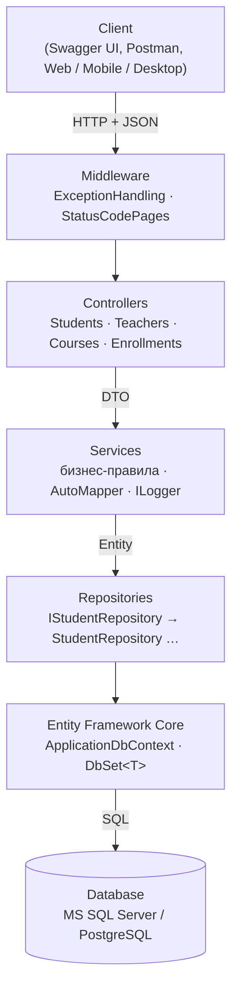

# University Course Management API

REST Web API на **ASP.NET Core 8** для системы управления университетскими курсами: студенты, преподаватели, учебные курсы и записи студентов на курсы.
Данные хранятся в реальной БД (**MS SQL Server** по умолчанию или **PostgreSQL**) через **Entity Framework Core**.

Учебный проект по дисциплине CSE5032 «Разработка веб-сервисов», задание 1 (модули 1–4).

## Технологии

| Что | Чем реализовано |
|---|---|
| Web API | ASP.NET Core 8, `[ApiController]`, `ControllerBase`, атрибутная маршрутизация |
| ORM / БД | Entity Framework Core 8, MS SQL Server (миграции) или PostgreSQL (Npgsql) |
| Слои | Controller → Service → Repository → `ApplicationDbContext` |
| Маппинг | AutoMapper 15 (`Mapping/MappingProfile.cs`) |
| Валидация | Data Annotations на DTO + собственный атрибут `[BirthDate]` + `IValidatableObject` |
| Ответы | единый формат `ReturnResult<T>` для всех endpoints, включая ошибки 404/405/415/500 |
| Ошибки | `ExceptionHandlingMiddleware` (500 без технических деталей, подробности — в лог) |
| Логирование | `ILogger` → консоль + файл `UniversityApi/logs/app-ГГГГММДД.log` |
| Документация | Swagger / OpenAPI (Swashbuckle) с описаниями и примерами из XML-комментариев |

## Схема архитектуры



```
Client (Swagger / Postman)
   ↓ HTTP (JSON)
Controller            — принимает запрос, отдаёт ReturnResult<T> с нужным HTTP-кодом
   ↓ DTO
Service               — бизнес-правила, проверки, маппинг DTO ↔ Entity, логирование
   ↓ Entity
Repository            — запросы к данным (GetAllAsync, GetByIdAsync, AddAsync, UpdateAsync, DeleteAsync …)
   ↓
Entity Framework Core — ApplicationDbContext, DbSet<Student/Teacher/Course/Enrollment>
   ↓ SQL
Database              — MS SQL Server или PostgreSQL
```

## Структура проекта

```
UniversityCourseManagement/
├── UniversityCourseManagement.sln
├── UniversityApi/
│   ├── Controllers/            ApiControllerBase, Students, Teachers, Courses, Enrollments, Diagnostics
│   ├── Models/                 Student, Teacher (Data Annotations), Course, Enrollment (Fluent API)
│   ├── DTO/                    Students/ Teachers/ Courses/ Enrollments/ — Create/Update/Dto/Filter
│   ├── Data/
│   │   ├── ApplicationDbContext.cs
│   │   ├── Configurations/     CourseConfiguration, EnrollmentConfiguration (Fluent API)
│   │   └── Seed/DbSeeder.cs    тестовые данные при первом запуске
│   ├── Migrations/             миграция InitialCreate (SQL Server)
│   ├── Repositories/
│   │   ├── Interfaces/         IRepository<T>, IStudentRepository, ITeacherRepository, ICourseRepository, IEnrollmentRepository
│   │   └── Implementations/    Repository<T>, StudentRepository, …
│   ├── Services/
│   │   ├── Interfaces/         IStudentService, …
│   │   └── Implementations/    StudentService, TeacherService, CourseService, EnrollmentService
│   ├── Mapping/MappingProfile.cs
│   ├── Middleware/ExceptionHandlingMiddleware.cs
│   ├── Common/                 ReturnResult<T>, ErrorCodes, Validation/, Logging/FileLoggerProvider
│   ├── Extensions/             регистрация DI, ответ валидации, инициализация БД, StatusCodePages
│   ├── Program.cs
│   └── appsettings.json
├── database/
│   ├── sqlserver/01_schema.sql, 02_seed_data.sql
│   └── postgresql/university_course_db_dump.sql
└── postman/UniversityApi.postman_collection.json
```

## Запуск

Нужен **.NET SDK 8** или новее (проект собран под `net8.0` с `RollForward=Major`, поэтому запускается и на .NET 9/10).

### Вариант 1. MS SQL Server LocalDB (по умолчанию)

LocalDB ставится вместе с Visual Studio (нагрузка «ASP.NET и разработка веб-приложений»). Строка подключения уже в `appsettings.json`:

```
Server=(localdb)\MSSQLLocalDB;Database=UniversityCourseDb;Trusted_Connection=True;TrustServerCertificate=True
```

Для SQL Server Express замените сервер на `.\SQLEXPRESS`.

```bash
cd UniversityApi
dotnet run --launch-profile http
```

При первом запуске приложение само применит миграцию (создаст БД и таблицы) и заполнит её тестовыми данными: 5 преподавателей, 8 курсов, 8 студентов, 14 записей.
Swagger: **http://localhost:5096/swagger** (корень `/` перенаправляет туда же). В Visual Studio — открыть `UniversityCourseManagement.sln` и нажать F5 (профиль `http`).

### Вариант 2. PostgreSQL

В `appsettings.json` поменять провайдер и при необходимости пароль:

```json
"Database": { "Provider": "PostgreSql", "SeedTestData": true },
"ConnectionStrings": {
  "PostgreSql": "Host=localhost;Port=5432;Database=university_course_db;Username=postgres;Password=postgres"
}
```

Миграции в проекте сгенерированы для SQL Server (в них типы `nvarchar`, `datetime2`), поэтому для PostgreSQL схема создаётся из той же модели через `EnsureCreated()`.

### Вариант 3. Восстановить БД из скриптов

- SQL Server: создать пустую базу `UniversityCourseDb`, выполнить `database/sqlserver/01_schema.sql`, затем `02_seed_data.sql` (SSMS, Azure Data Studio или `sqlcmd -d UniversityCourseDb -i ...`).
- PostgreSQL: `createdb university_course_db` и `psql -d university_course_db -f database/postgresql/university_course_db_dump.sql`.

Миграции вручную (если нужно): `dotnet tool install -g dotnet-ef --version 8.0.32`, затем `dotnet ef database update` в папке `UniversityApi`.

## Endpoints

| Метод | URL | Описание | Успех | Ошибки |
|---|---|---|---|---|
| GET | `/api/students?search=` | все студенты (поиск по имени/email) | 200 | |
| GET | `/api/students/{id}` | студент по ID | 200 | 404 |
| GET | `/api/students/{id}/courses` | студент вместе с его курсами и оценками | 200 | 404 |
| POST | `/api/students` | создать студента | 201 + Location | 400, 409 |
| PUT | `/api/students/{id}` | изменить студента | 200 | 400, 404, 409 |
| DELETE | `/api/students/{id}` | удалить студента (записи удаляются каскадно) | 200 | 404 |
| GET | `/api/teachers?department=` | все преподаватели (фильтр по кафедре) | 200 | |
| GET | `/api/teachers/{id}` | преподаватель по ID | 200 | 404 |
| POST | `/api/teachers` | создать преподавателя | 201 | 400, 409 |
| PUT | `/api/teachers/{id}` | изменить преподавателя | 200 | 400, 404, 409 |
| DELETE | `/api/teachers/{id}` | удалить преподавателя (нельзя, если есть курсы) | 200 | 404, 409 |
| GET | `/api/courses?search=&teacherId=&department=&minCredits=&maxCredits=` | курсы с фильтрацией | 200 | 400 |
| GET | `/api/courses/{id}` | курс по ID (с именем преподавателя) | 200 | 404 |
| POST | `/api/courses` | создать курс и закрепить за преподавателем | 201 | 400, 404 |
| PUT | `/api/courses/{id}` | изменить курс / сменить преподавателя | 200 | 400, 404 |
| DELETE | `/api/courses/{id}` | удалить курс | 200 | 404 |
| GET | `/api/enrollments?studentId=&courseId=` | список записей | 200 | 400 |
| GET | `/api/enrollments/{id}` | запись по ID | 200 | 404 |
| POST | `/api/enrollments` | записать студента на курс | 201 | 400, 404, 409 |
| PUT | `/api/enrollments/{id}/grade` | изменить оценку (0–100) | 200 | 400, 404 |
| DELETE | `/api/enrollments/{id}` | удалить студента с курса | 200 | 404 |
| GET | `/api/diagnostics/error` | демонстрация обработки 500 (только Development) | — | 500 |

Пример тела `POST /api/students`:

```json
{ "firstName": "Alex", "lastName": "Smith", "email": "alex.smith@student.university.kz", "birthDate": "2004-05-15" }
```

## Единый формат ответа `ReturnResult<T>`

```json
{
  "statusCode": 404,
  "isSuccess": false,
  "result": null,
  "errorCode": "STUDENT_NOT_FOUND",
  "errorMessage": "Student with id 99999 not found",
  "traceId": "0HNPFVOJOL6K3:00000001"
}
```

Для ошибок валидации добавляется поле `errors` со списком сообщений по каждому полю. `traceId` совпадает с идентификатором запроса, по нему ошибку можно найти в логе. В формат приводятся и ответы, которые формирует сам ASP.NET Core: несуществующий URL (404 `ENDPOINT_NOT_FOUND`), неверный метод (405), не тот `Content-Type` (415).

| Код | Когда |
|---|---|
| 200 OK | успешное получение, изменение, удаление |
| 201 Created | создание объекта (+ заголовок `Location`) |
| 400 Bad Request | ошибка валидации DTO или некорректный JSON (`VALIDATION_ERROR`) |
| 404 Not Found | объект не найден, в том числе студент/курс/преподаватель, на которого ссылается запрос |
| 409 Conflict | повторная запись на курс, занятый email, удаление преподавателя с курсами |
| 500 Internal Server Error | непредвиденная ошибка; клиенту — только код и `traceId`, подробности — в лог |

## Бизнес-правила

1. Нельзя записать студента на несуществующий курс → 404 `COURSE_NOT_FOUND`.
2. Нельзя записать несуществующего студента → 404 `STUDENT_NOT_FOUND`.
3. Один студент не может быть дважды записан на один курс → 409 `STUDENT_ALREADY_ENROLLED`. Проверяется в сервисе и дополнительно уникальным индексом `(StudentId, CourseId)` в БД (при одновременных запросах — 409 `DATABASE_CONFLICT`).
4. Курс не может ссылаться на несуществующего преподавателя → 404 `TEACHER_NOT_FOUND`.
5. Несуществующий объект никогда не возвращается как успех → 404 с кодом `*_NOT_FOUND`.

Дополнительно: email студента и преподавателя уникален (409), нельзя удалить преподавателя, за которым закреплены курсы (409, `DeleteBehavior.Restrict`).

## Конфигурация модели EF Core

- **Conventions**: свойство `Id` становится первичным ключом, `TeacherId`/`StudentId`/`CourseId` распознаются как внешние ключи по навигационным свойствам.
- **Data Annotations** (`Student`, `Teacher`): `[Key]`, `[Required]`, `[MaxLength]`, `[Table]`, `[Index(IsUnique = true)]`.
- **Fluent API** (`Course`, `Enrollment` в `Data/Configurations`): `HasKey`, `IsRequired`, `HasMaxLength`, `HasPrecision`, `HasOne/WithMany/HasForeignKey`, `OnDelete`, уникальный составной индекс, CHECK-ограничения (кредиты 1–10, оценка 0–100).

## Dependency Injection и lifetime

Регистрация — в `Extensions/ServiceCollectionExtensions.cs`, вызывается из `Program.cs`.

| Сервис | Lifetime | Почему |
|---|---|---|
| `ApplicationDbContext` | Scoped | один контекст на HTTP-запрос: он не потокобезопасен и хранит Change Tracker |
| Репозитории | Scoped | зависят от `DbContext`, должны жить столько же; Singleton «захватил» бы контекст навсегда |
| Сервисы | Scoped | зависят от Scoped-репозиториев; все репозитории одного запроса работают с одним контекстом |
| AutoMapper | конфигурация — Singleton | правила маппинга строятся один раз при старте |

## Логирование

`ILogger<T>` внедряется в сервисы и middleware. Уровни:
- **Information** — создание, изменение, удаление объектов, применение миграций, заполнение БД;
- **Warning** — попытка получить несуществующий объект, нарушение бизнес-правил, ошибки валидации;
- **Error** — необработанные исключения (с полным StackTrace, только в логе).

Логи выводятся в консоль и в файл `UniversityApi/logs/app-ГГГГММДД.log`. Чтобы видеть SQL-запросы EF Core, в `appsettings.Development.json` поставьте `"Microsoft.EntityFrameworkCore.Database.Command": "Information"`.

> При старте AutoMapper 15 пишет предупреждение об отсутствии лицензионного ключа. Для учебного (некоммерческого) использования это допускается. Бесплатный Community-ключ можно получить на luckypennysoftware.com и вписать в `AutoMapper:LicenseKey`. Версия 14 бесплатна по MIT, но в ней есть уязвимость CVE-2026-32933, поэтому в проекте используется исправленная 15.1.1.

## Проверка через Postman

Импортируйте `postman/UniversityApi.postman_collection.json` и запустите коллекцию целиком (Run collection). Папки повторяют 15 сценариев из задания (раздел 21). ID созданных объектов сохраняются в переменные коллекции, а в каждом запросе есть тесты на HTTP-код и формат ответа. Коллекцию можно запускать повторно: email содержит `{{$timestamp}}`.

Проверено: на SQL Server 2022 и PostgreSQL 16 проходят 35 запросов и 93 проверки.
